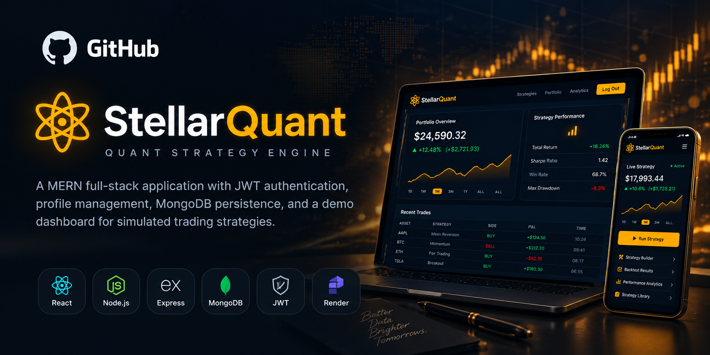

# 📊 StellarQuant

### A MERN stack software engineering project

A full-stack demo application featuring user authentication, profile management, and a simulated strategy dashboard.

[](https://zeropeak.me)
[](https://zerocore.me)

**Status:** Deployed demo · **Source code:** Private

</div>

---

## ✨ Overview

**StellarQuant** is a full-stack demo application built to practice frontend/backend integration, authentication, database persistence, and deployment. It includes a dashboard for simulated strategies; it is **not a production trading platform**.

## 🚀 Features

- **User authentication** — Account authentication using JWT.
- **Profile management** — Manage user profile information.
- **Data persistence** — Store and retrieve application data with MongoDB.
- **Simulated strategy dashboard** — Explore a demonstration dashboard for strategy-related information.
- **Deployed frontend & backend** — React frontend on Vercel, with a Node.js/Express API on Render.

## 🛠️ Tech Stack


## 🧩 Application Structure

```text
React frontend (Vercel)
       │
       ▼
Node.js + Express API (Render)
       │
       ▼
     MongoDB

JWT-based authentication
```

## 🖼️ Screenshots

Add screenshots of the dashboard and profile experience here.

<!--
1. Create an assets/ folder in this public showcase repository.
2. Upload screenshots that do NOT expose private user data or credentials.
3. Replace this comment with, for example:


-->
## 📸 Project Preview



## 💡 What This Project Demonstrates

- Creating a MERN full-stack application
- Designing and connecting REST API routes
- Implementing JWT authentication
- Working with MongoDB-backed application data
- Deploying and integrating separately hosted frontend and backend services

## 🔗 Links

- **Live demo:** [zeropeak.me](https://zeropeak.me)
- **Developer portfolio:** [zerocore.me](https://zerocore.me)
- **LinkedIn:** [Joshua Morales](https://www.linkedin.com/in/joshuamoralescsc/)

> **About this repository:** This is a public project showcase. The application source code remains private. The dashboard is a software demonstration, not a real trading service.
